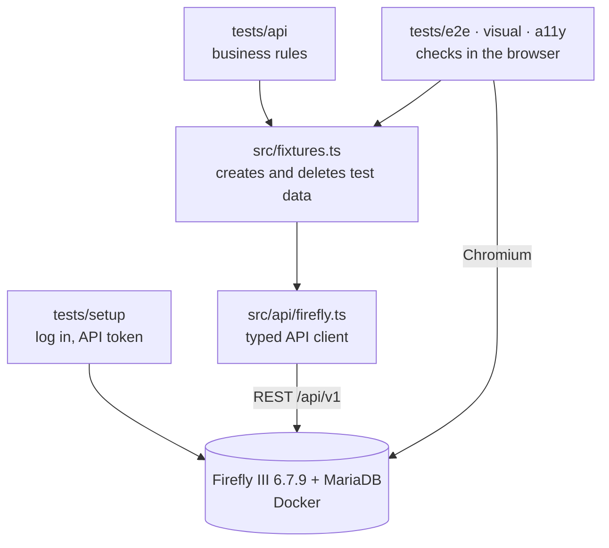

# firefly-iii-playwright

[](https://github.com/emmanuelplougoulm/firefly-iii-playwright/actions/workflows/tests.yml)

A Playwright + TypeScript test suite for [Firefly III](https://github.com/firefly-iii/firefly-iii), an open-source personal finance manager. The app runs in Docker, both locally and in CI, so every run starts from a known state.

The suite covers four layers:

| Layer | What it checks | Where |
|---|---|---|
| API | Business rules, through the REST API only (no browser) | `tests/api` |
| End to end | Data created through the API, then checked in the UI | `tests/e2e` |
| Visual regression | Screenshots compared against Linux baselines generated in CI | `tests/visual` |
| Accessibility | axe (WCAG 2.1 A/AA), with known violations tracked per page | `tests/a11y` |

## Architecture



- **Setup project.** On a fresh instance it registers the first user, who becomes admin, with a random password stored in `.auth/` (gitignored). Later runs log in. It saves the browser session and issues a personal access token for the API.
- **Data goes in through the API, checks happen in the UI.** The `assetAccount` fixture creates accounts with unique names and deletes them after the test, so tests stay independent when they run in parallel.
- **Separate API project.** API tests run without a browser and take well under a second each.

## Run it

Requirements: Node 22+ and Docker (Docker Desktop, or [Colima](https://github.com/abiosoft/colima) on macOS).

```bash
npm ci
npx playwright install chromium
npm run app:up      # Firefly III on http://localhost:8080
npm test
npm run report      # HTML report
npm run app:down    # stop and wipe the data
```

Screenshots render differently on macOS and Linux, so local runs skip the visual comparison (`ignoreSnapshots` outside CI). The baselines live in the repo and are compared in CI.

## Keeping the tests stable

- **Pinned app version** (`fireflyiii/core:version-6.7.9`), so an upstream UI change cannot break the baselines unannounced.
- **Fixed data in the past.** The visual test uses January 2026: the chart has no moving "today" marker, and amounts and dates are fixed.
- **Masking.** The header date range follows the current month, so it is masked.
- **Baselines from CI.** Missing baselines are generated on Linux and committed by the workflow. A manual run with `update_snapshots` regenerates them all.
- **Accessibility debt as a baseline.** `tests/a11y/known-violations.json` records, for each page, the axe rules that already fail and how many elements they hit. A test fails on a new rule or a higher count. After a fix, lower the count, or regenerate with `UPDATE_A11Y_BASELINE=1`.

## What the suite found

Findings on Firefly III 6.7.9, reproducible with this suite:

1. **The month summary on the account page changes between two identical visits.** On the first view of a period it shows 2 rows (Transactions, Spent); from the second view on, it shows 5 (Earned and transfers too). The server cache seems to be involved. The visual test loads the page twice before capturing.
2. **That summary box overflows at 1280 px.** Amounts are cut off on the right edge (visible in the baseline screenshot).
3. **Accessibility.** The login page has no axe violation. The new withdrawal form has the most: 8 buttons without an accessible name, an unlabelled select, insufficient colour contrast and an incomplete ARIA structure. The sidebar alone adds 5 links without a name and 18 misplaced list items to every page.
4. **No overdraft guard.** A withdrawal larger than the balance is accepted and the balance goes negative. This is a design choice (Firefly III records what happened), pinned by a test so a change would be noticed.

## Project layout

```
docker/compose.yml        Firefly III + MariaDB, test-only settings
playwright.config.ts      projects: setup, api, chromium
src/api/firefly.ts        typed client for the endpoints in use
src/fixtures.ts           api and assetAccount fixtures
src/a11y.ts               axe scan + accessibility debt baseline
tests/setup/              registration or login, API token
tests/api/                business rules through the API
tests/e2e/                API-seeded journeys checked in the UI
tests/visual/             visual regression + Linux baselines
tests/a11y/               axe scans + known-violations.json
.github/workflows/        CI: start the stack, type-check, test, commit new baselines
```

## About Firefly III

Firefly III is developed by James Cole under AGPL-3.0. This repository only runs its official container image; none of its code is included here.
