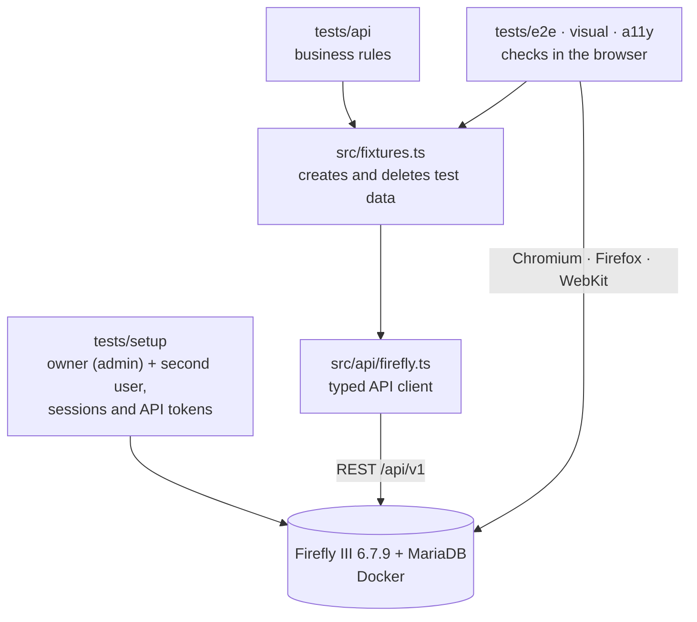

# firefly-iii-playwright

[](https://github.com/emmanuelplougoulm/firefly-iii-playwright/actions/workflows/tests.yml)

A Playwright + TypeScript test suite for [Firefly III](https://github.com/firefly-iii/firefly-iii), an open-source personal finance manager. The app runs in Docker, both locally and in CI, so every run starts from a known state.

The suite covers five layers:

| Layer | What it checks | Where | Browsers |
|---|---|---|---|
| API | Business rules and automation rules, through the REST API only (no browser) | `tests/api` | none |
| Authorization | A second user cannot read, change or spend from the first user's data; admin-only endpoints are closed to regular users | `tests/api`, `tests/e2e` (`@security`) | none, then all three |
| End to end | Data created through the API, then checked in the UI; server errors and rejected fields injected with `page.route` | `tests/e2e` | Chromium, Firefox, WebKit |
| Visual regression | Screenshots compared against Linux baselines generated in CI | `tests/visual` | Chromium |
| Accessibility | axe (WCAG 2.1 A/AA) with known violations tracked per page, a keyboard-only journey, the guided tour closed from the keyboard | `tests/a11y` | Chromium |

Tags select a slice: `@smoke` (a few minutes' confidence, run first in CI) and `@security` (authorization).

## Architecture



- **Setup project.** On a fresh instance it registers the first user, who becomes admin, with a random password stored in `.auth/` (gitignored). Later runs log in. It saves the browser session and issues a personal access token for the API. As admin, it then reopens registration through the configuration API and signs up a second, unrelated user for the authorization tests.
- **Test users.** `api` and `assetAccount` act as the owner; `otherUserRequest` is the second user's API context; `newUser` registers a user for one test only and deletes it afterwards (used where per-user server state, like the guided tour, would otherwise leak between tests).
- **Page object where it pays off.** `src/pages/withdrawal-form.ts` wraps the one form several specs drive. Simple pages are used directly in the specs.
- **Data goes in through the API, checks happen in the UI.** The `assetAccount` fixture creates accounts with unique names and deletes them after the test, so tests stay independent when they run in parallel.
- **Separate API project.** API tests run without a browser and take well under a second each.

## Run it

Requirements: Node 22+ and Docker (Docker Desktop, or [Colima](https://github.com/abiosoft/colima) on macOS).

```bash
npm ci
npx playwright install chromium firefox webkit
npm run app:up      # Firefly III on http://localhost:8080
npm test            # everything
npm run test:smoke  # @smoke only, API + Chromium
npm run test:api    # API layer, no browser
npm run report      # HTML report
npm run app:down    # stop and wipe the data
```

Screenshots render differently on macOS and Linux, so local runs skip the visual comparison (`ignoreSnapshots` outside CI). The baselines live in the repo and are compared in CI.

## CI

`.github/workflows/tests.yml`:

1. **Smoke gate.** Type check, then `@smoke` on the API and Chromium. The matrix only starts if it passes.
2. **Matrix.** One job per project (`api`, `chromium`, `firefox`, `webkit`), each against its own fresh Firefly III in Docker. The `chromium` job also commits missing visual baselines.
3. **One report.** Each job writes a blob report; a last job merges them into a single HTML report (artifact) and writes a pass/fail table per project in the run summary (`scripts/summary.mjs`).

## Keeping the tests stable

- **Pinned app version** (`fireflyiii/core:version-6.7.9`), so an upstream UI change cannot break the baselines unannounced.
- **Fixed data in the past.** The visual test uses January 2026: the chart has no moving "today" marker, and amounts and dates are fixed.
- **Masking.** The header date range follows the current month, so it is masked.
- **Baselines from CI.** Missing baselines are generated on Linux and committed by the workflow. A manual run with `update_snapshots` regenerates them all.
- **No shared per-user state.** Firefly III stores some UI state per user on the server (the guided tour shown on a first visit). Setup marks it as seen for the shared users; the test about the tour uses a user of its own.
- **Waiting on real signals, not time.** Tests wait for the request that saves a state, or for the focus to land, never for a fixed delay.
- **Accessibility debt as a baseline.** `tests/a11y/known-violations.json` records, for each page, the axe rules that already fail and how many elements they hit. A test fails on a new rule or a higher count. After a fix, lower the count, or regenerate with `UPDATE_A11Y_BASELINE=1`.

## What the suite found

Findings on Firefly III 6.7.9, reproducible with this suite:

1. **The month summary on the account page changes between two identical visits.** On the first view of a period it shows 2 rows (Transactions, Spent); from the second view on, it shows 5 (Earned and transfers too). The server cache seems to be involved. The visual test loads the page twice before capturing.
2. **That summary box overflows at 1280 px.** Amounts are cut off on the right edge (visible in the baseline screenshot).
3. **Accessibility.** The login page has no axe violation. The new withdrawal form has the most: 8 buttons without an accessible name, an unlabelled select, insufficient colour contrast and an incomplete ARIA structure. The sidebar alone adds 5 links without a name and 18 misplaced list items to every page.
4. **The form works with the keyboard alone, with gaps for screen readers.** A withdrawal can be entered and submitted without a mouse: the description field has autofocus and the account autocomplete answers to the arrow keys. But every autocomplete field is a `combobox` with an empty accessible name, so a screen reader announces it without saying what it is for.
5. **No overdraft guard.** A withdrawal larger than the balance is accepted and the balance goes negative. This is a design choice (Firefly III records what happened), pinned by a test so a change would be noticed.
6. **A rejected field does not say why.** When the API rejects a field (say, an amount of zero), the field gets a red border and an icon, but its message stays hidden: it is rendered in an `.invalid-feedback` element that is not a sibling of the input, so Bootstrap keeps it at `display: none`. Screen readers do hear it, through the page's live region; sighted users only see the generic banner. Pinned with `test.fail` in `tests/e2e/withdrawal-form.spec.ts`: the day it is fixed, that test reports it.
7. **Wrong status for a forbidden endpoint.** A signed-in regular user calling `GET /api/v1/users` (admin only) gets `401 Unauthorized` instead of `403 Forbidden`. Access is refused, so it is not a leak, but a client cannot tell "sign in again" from "you are not allowed".
8. **Database deadlock under parallel load.** Once in about 150 tests run in parallel, `POST /api/v1/accounts` failed with a 500 and a MariaDB deadlock (`SQLSTATE 40001`, error 1213) on the statement that reorders the user's accounts. 360 concurrent create/delete calls in isolation did not reproduce it, so it needs more concurrent work on the same user. The CI retry turns it into a "flaky" result in the report, rather than hiding it.

The authorization layer found no leak: another user gets a `404` (not `403`, so ids are not confirmed) for the owner's accounts and transactions, in the API and in the UI, and cannot spend from the owner's account.

## Project layout

```
docker/compose.yml        Firefly III + MariaDB, test-only settings
playwright.config.ts      projects: setup, api, chromium, firefox, webkit; test users
src/api/firefly.ts        typed client for the endpoints in use
src/fixtures.ts           api, assetAccount, categoryRule, otherUserRequest, newUser
src/auth.ts               register / log in through the forms
src/pages/                page object for the withdrawal form
src/a11y.ts               axe scan + accessibility debt baseline
scripts/summary.mjs       merged JSON report -> CI run summary
tests/setup/              both users: registration or login, API tokens
tests/api/                business rules and authorization through the API
tests/e2e/                API-seeded journeys, injected failures, cross-user access
tests/visual/             visual regression + Linux baselines
tests/a11y/               axe scans + known-violations.json
.github/workflows/        CI: smoke gate, one job per project, merged report
```

## About Firefly III

Firefly III is developed by James Cole under AGPL-3.0. This repository only runs its official container image; none of its code is included here.
